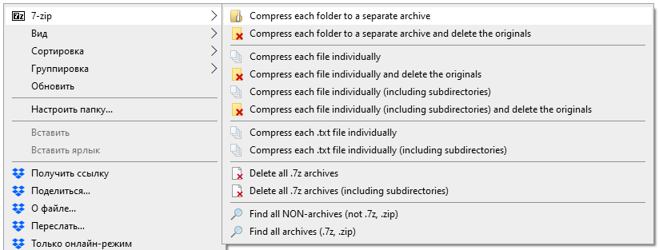

# 7-zip_shell_extension
*Adds convenient choices to the context menu*

**7-zip_shell_extension.reg** - add options to context menu using Windows Registry.

**7-zip_shell_extension_DELETE.reg** - remove context menu options.
